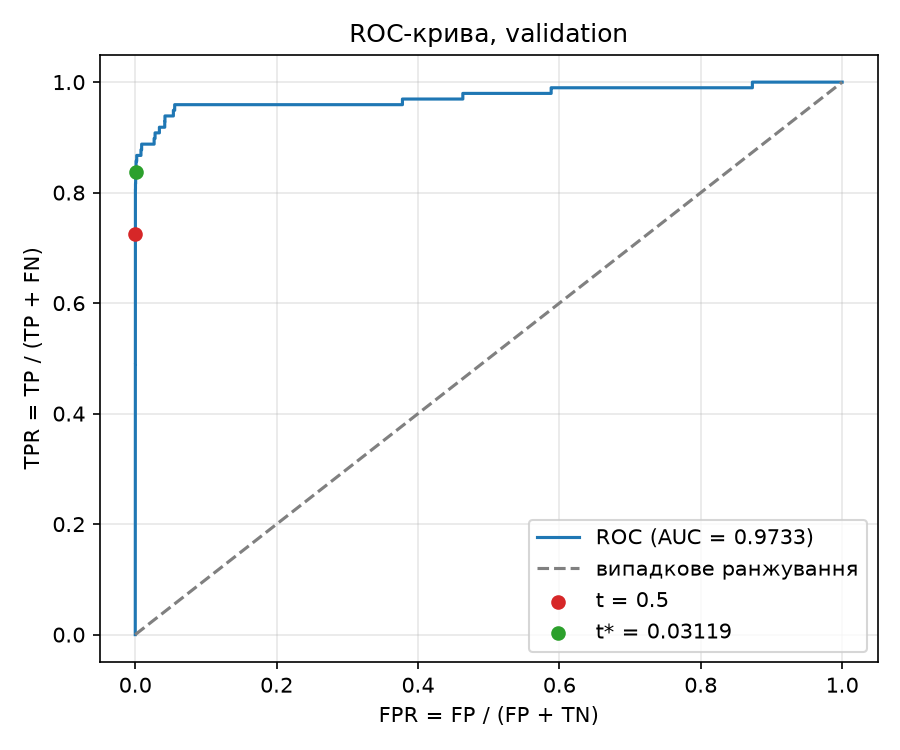
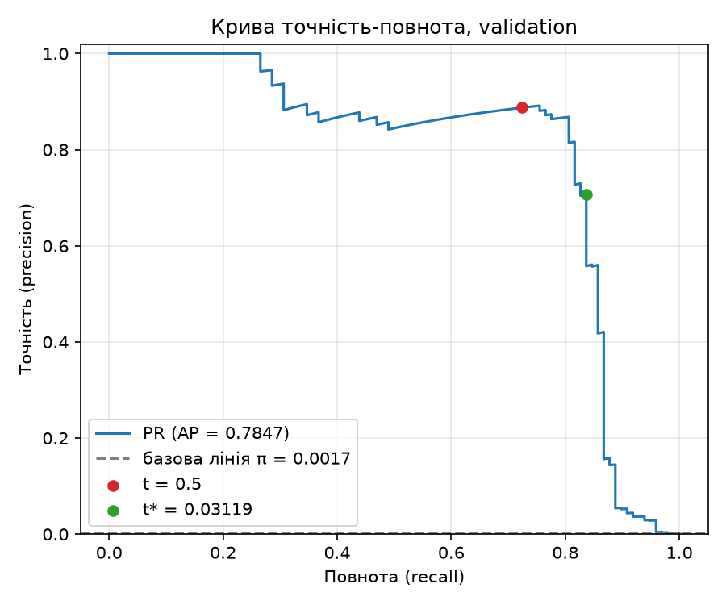

# Лабораторна робота №2. Поріг рішення під асиметричну ціну помилок

У роботі я навчила задану нейронну мережу виявляти шахрайські транзакції та підібрала для неї поріг рішення $t$. 
Пропущене шахрайство коштує в десять разів дорожче за хибну тривогу, тому оптимальний поріг не збігається зі 
стандартним $0.5$. Поріг шукається на validation через сортування й кумулятивні суми, перевіряється незалежним повільним 
перебором на трьох малих наборах і лише після цього застосовується до test.

---

## 1. Відтворення результатів

**Набір даних:** Credit Card Fraud Detection, 284 807 транзакцій, з них 492 шахрайські: https://www.kaggle.com/datasets/mlg-ulb/creditcardfraud 
(для завантаження потрібен обліковий запис Kaggle). Файл `creditcard.csv` у репозиторії не зберігається. Його потрібно 
розпакувати в будь-яке місце, а шлях передати параметром `--data`.

```bash
cd lab2
uv sync

# 1. Навчання з локального CSV (шлях замість <ШЛЯХ_ДО_CSV>); тека results має бути порожньою або відсутньою
uv run python lab2_starter.py --data <ШЛЯХ_ДО_CSV> --out results

# 2. Аналіз зі збережених прогнозів (без навчання і без CSV)
uv run python analysis.py --saved results --out analysis
```

Приклади шляху: `C:\data\creditcard.csv` (Windows), `~/data/creditcard.csv` (Linux/macOS).

| Компонент | Версія |
|---|---|
| Python | 3.12 |
| NumPy | 2.5.4 |
| pandas | 3.0.6 |
| scikit-learn | 1.9.1 |
| PyTorch | 2.14.1 |
| Matplotlib | 3.11.2 |

Версії зафіксовано в `pyproject.toml` і `uv.lock`. Збережені прогнози лежать у репозиторії, тому друга команда відтворює 
всі числа цього звіту без повторного навчання. Повторне навчання дає той самий поділ і ті самі статистики стандартизації, 
але оцінки можуть відрізнятися в молодших розрядах залежно від версії PyTorch і платформи.

## 2. Структура теки

| Файл / тека | Вміст |
|---|---|
| `lab2_starter.py` | код викладача: поділ, стандартизація, навчання, збереження прогнозів (не змінювався) |
| `thresholds.py` | `confusion`, `cost`, `precision_recall`, швидкий пошук порога через кумулятивні суми |
| `check_search.py` | незалежна повільна перевірка пошуку на наборах A, B, C |
| `plots.py` | PR- і ROC-криві на validation |
| `evaluation.py` | тестова оцінка із зафіксованим порогом, розбір помилок |
| `analysis.py` | запускає весь аналіз у потрібному порядку |
| `results/` | ваги моделі, індекси поділу, мітки та прогнози, параметри стандартизації |
| `analysis/` | таблиця кандидатів, результати перевірок, малюнки, поріг, тестові результати |
| `pyproject.toml`, `uv.lock` | залежності із зафіксованими версіями |
| `src/lab2/` | порожня заготовка від `uv init`, не використовується |

Вміст `analysis/`: `validation_candidates.csv`, `check_A.csv`, `check_B.csv`, `check_C.csv`, `validation_roc.png`, `validation_pr.png`, `threshold.json`, `test_metrics.json`, `test_errors.csv`.

## 3. Дані та поділ

Використано 29 ознак: $V_1,\dots,V_{28}$ і `Amount`. Стовпці `Class` і `Time` до входу моделі не входять. Сире значення
 `Amount` зберігається окремо для аналізу помилок.

Поділ 60/20/20 стратифікований за `Class` і виконується над індексами рядків CSV: спочатку 
`train_test_split(test_size=0.4, stratify=Class, random_state=0)`, потім відкладені індекси діляться навпіл (`test_size=0.5`,
 стратифікація за відповідними мітками, `random_state=0`). Перша частина це validation, друга test. Початковий порядок 
рядків CSV зберігається в `*_row_ids`.

| Вибірка | Об'єктів | Шахрайських | Частка шахрайських |
|---|---:|---:|---:|
| train | 170 884 | 295 | 0.1726 % |
| validation | 56 961 | 98 | 0.1720 % |
| test | 56 962 | 99 | 0.1738 % |

Стратифікація зберегла частку шахрайських у всіх трьох вибірках.

**Чому статистики стандартизації не можна обчислювати на всьому наборі.** Середнє й стандартне відхилення, пораховані на 
всіх даних, містять інформацію про validation і test. Тоді модель і поріг опосередковано «бачили» дані, на яких їх потім 
оцінюють, і оцінка стає оптимістичною (витік даних). Тому `StandardScaler` навчається лише на train, а до validation і test 
застосовуються ті самі статистики, так само як це буде з новими транзакціями після розгортання моделі.

Класи не балансувалися ні відкиданням, ні дублюванням.

## 4. Модель і навчання

Модель `Linear(29, 32) → ReLU → Linear(32, 1)`, втрата `BCEWithLogitsLoss` без зважування класів, оптимізатор Adam зі 
швидкістю $10^{-3}$, 12 епох, пакет 1024, CPU, `float32`. Використано ваги після 12-ї епохи, без вибору епохи за validation.
 Значення BCE на train зменшилося з 0.3653 на першій епосі до 0.003383 на дванадцятій.

Оцінка шахрайства $s_i = \mathrm{sigmoid}(z_i)$, де $z_i$ це вихідний логіт. Оцінки для validation і test зберігаються 
без округлення.

## 5. Метрики та вартість

Правило рішення: прогнозуємо шахрайство, якщо $s_i \ge t$.

$$
TP=\sum_i \mathbb{1}[s_i\ge t,\ y_i=1],\qquad
FP=\sum_i \mathbb{1}[s_i\ge t,\ y_i=0],
$$

$$
FN=\sum_i \mathbb{1}[s_i< t,\ y_i=1],\qquad
TN=\sum_i \mathbb{1}[s_i< t,\ y_i=0].
$$

Вартість помилок (пропущене шахрайство в десять разів дорожче; `Amount` у формулу не входить):

$$
C(t) = 10\cdot FN(t) + FP(t).
$$

$$
\text{precision} = \frac{TP}{TP+FP},\qquad
\text{recall} = \frac{TP}{TP+FN},\qquad
\text{FPR} = \frac{FP}{FP+TN}.
$$

Якщо знаменник дорівнює нулю, метрика не визначена. Precision не визначена, коли модель не позначила жодної транзакції 
шахрайською ($TP+FP=0$), а recall, коли у вибірці немає шахрайських транзакцій ($TP+FN=0$).

## 6. Пошук порога

**Кандидати.** Усі унікальні оцінки validation та $t=+\infty$. Поріг $+\infty$ означає «усі негативні», а найменша оцінка 
означає «усі позитивні».

**Алгоритм.**

1. Сортуємо об'єкти за спаданням оцінки: $O(n\log n)$.
2. Поріг, що дорівнює оцінці $k$-го об'єкта в такому порядку, відокремлює перші $k$ об'єктів від решти. Кумулятивні 
суми дають $TP(k)=\sum_{j\le k} y_j$ і $FP(k)=k-TP(k)$.
3. Далі $FN=P-TP$ і $TN=N-FP$, де $P$ і $N$ це кількості шахрайських і легітимних об'єктів.
4. Кожен поріг обчислюється за $O(1)$ з уже готових сум, без повторного проходу по вибірці.

**Рівні оцінки.** Поріг не може розділити об'єкти з однаковою оцінкою: вони або всі проходять правило $s\ge t$, або всі ні. 
Тому з кожної групи рівних значень беремо лише останній елемент, коли суми вже враховують усю групу.

**Кілька мінімумів.** Якщо мінімум $C$ досягається на кількох порогах, обирається найбільший із них. У коді це робиться 
явно: серед усіх індексів із мінімальною $C$ береться той, де поріг найбільший.

Таблицю всіх кандидатів збережено в `analysis/validation_candidates.csv` без округлення (55 954 рядки: 55 953 унікальні 
оцінки та $+\infty$). Швидкий підрахунок додатково звірено з прямим застосуванням правила $s\ge t$ у 30 випадкових рядках 
таблиці та в обох крайніх.

## 7. Результати на validation

Мінімальна вартість $C=194$ досягається на єдиному порозі:

$$
t^* = 0.031193982809782028 \approx 0.031194
$$

Поріг записано в `analysis/threshold.json`.

| Правило на validation | Поріг | TP | FP | FN | TN | C |
|---|---:|---:|---:|---:|---:|---:|
| Стандартний поріг | 0.5 | 71 | 9 | 27 | 56 854 | 279 |
| Мінімум вартості | 0.031194 | 82 | 34 | 16 | 56 829 | 194 |
| Усі негативні | $+\infty$ | 0 | 0 | 98 | 56 863 | 980 |

Перехід від $0.5$ до $t^*$ відловив ще 11 шахрайських транзакцій (економія $11\cdot10=110$) ціною 25 додаткових хибних 
тривог, і вартість зменшилась із 279 до 194.

### Криві

ROC-AUC на validation дорівнює $0.9733$, середня точність (AP) дорівнює $0.7847$ при частці шахрайських $\pi=0.00172$.





**Чому висока ROC-AUC не гарантує малої вартості чи високої precision.** ROC-AUC оцінює якість ранжування за всіма порогами 
одразу й не залежить ні від ціни помилок, ні від частки шахрайських. Вартість же визначається однією робочою точкою. 
Precision залежить від частки позитивних:

$$
\text{precision} = \frac{\pi\,\text{TPR}}{\pi\,\text{TPR} + (1-\pi)\,\text{FPR}}.
$$

Легітимних транзакцій у 580 разів більше, ніж шахрайських ($56\,863/98$), тому навіть дуже малий FPR дає багато хибних 
тривог на фоні небагатьох справжніх виявлень. Для $t^*$: $\text{FPR}=34/56\,863\approx0.0006$ (на ROC-кривій це майже кут), 
а precision $=82/116\approx0.71$. До того ж AUC не знає, що $FN$ коштує в десять разів більше за $FP$. Крива точність-повнота
показує цю різницю краще: базова лінія $\pi\approx0.0017$ дуже низька, а AP дорівнює $0.78$.

## 8. Перевірка пошуку порога на малих наборах

Для кожного набору будувався власний список кандидатів, а матриця плутанини й $C$ обчислювались прямим застосуванням правила 
$s\ge t$ до кожного кандидата. Результати швидкого алгоритму не використовувались для побудови перевірочного, а лише 
порівнювались із ним. Усі лічильники й вартості збіглися точно, а обрані пороги відповідають тому самому правилу розв'язання 
нічиєї та ручному розрахунку.

**Набір A.** $s=[0.9,\,0.7,\,0.7,\,0.4,\,0.2,\,0.1]$, $y=[0,\,1,\,0,\,1,\,0,\,0]$

| Поріг | TP | FP | FN | TN | C |
|---:|---:|---:|---:|---:|---:|
| $+\infty$ | 0 | 0 | 2 | 4 | 20 |
| 0.9 | 0 | 1 | 2 | 3 | 21 |
| 0.7 | 1 | 2 | 1 | 2 | 12 |
| 0.4 | 2 | 2 | 0 | 2 | 2 |
| 0.2 | 2 | 3 | 0 | 1 | 3 |
| 0.1 | 2 | 4 | 0 | 0 | 4 |

Обраний $t^*=0.4$, $C=2$. Оцінка $0.7$ зустрічається двічі з різними мітками (1 і 0). Порогом їх розділити неможливо: 
при $t=0.7$ обидва об'єкти прогнозуються позитивними, а при $t=0.9$ обидва негативними. Тому в таблиці немає кандидата 
«один із двох», і саме це перевіряє набір A.

**Набір B.** $s=[0.9,\,0.6,\,0.3]$, $y=[0,\,0,\,0]$

| Поріг | TP | FP | FN | TN | C |
|---:|---:|---:|---:|---:|---:|
| $+\infty$ | 0 | 0 | 0 | 3 | 0 |
| 0.9 | 0 | 1 | 0 | 2 | 1 |
| 0.6 | 0 | 2 | 0 | 1 | 2 |
| 0.3 | 0 | 3 | 0 | 0 | 3 |

Обраний $t^*=+\infty$, $C=0$. Позитивних міток немає, тому $FN=0$ завжди, а вартість дорівнює кількості хибних тривог. 
Нуль досягається лише на порозі «усі негативні», і тому цей кандидат обов'язково має бути в списку. Recall тут не визначений,
 бо $TP+FN=0$.

**Набір C.** $s=[0.8,\ 0.5\ (\times 11),\ 0.2]$, $y=[1,\ 1,\ 0\ (\times 10),\ 0]$: одинадцять оцінок $0.5$ підряд, перша 
з міткою 1, решта десять з міткою 0.

| Поріг | TP | FP | FN | TN | C |
|---:|---:|---:|---:|---:|---:|
| $+\infty$ | 0 | 0 | 2 | 11 | 20 |
| 0.8 | 1 | 0 | 1 | 11 | 10 |
| 0.5 | 2 | 10 | 0 | 1 | 10 |
| 0.2 | 2 | 11 | 0 | 0 | 11 |

Обраний $t^*=0.8$, $C=10$. Два кандидати, $0.8$ і $0.5$, мають однакову вартість: на $0.8$ пропущено одне шахрайство 
($10\cdot1$), а на $0.5$ спіймано обидва, але з десятьма хибними тривогами ($10\cdot0+10$). За правилом нічиєї береться 
більший поріг, $0.8$. Одинадцять рівних оцінок $0.5$ при цьому утворюють один кандидат.

Усі три перевірки пройдено, тому далі можна було переходити до test.

## 9. Тестова оцінка

Поріг $t^*=0.031193982809782028$ зафіксовано на validation і записано в `threshold.json` до оцінки test. Test не 
використовувався для зміни порога, моделі чи налаштувань. Рядки з $0.5$ та «усі негативні» наведено лише для порівняння.

| Test | Поріг | TP | FP | FN | TN | C | Precision | Recall |
|---|---:|---:|---:|---:|---:|---:|---:|---:|
| $t^*$ (зафіксований) | 0.031194 | 80 | 43 | 19 | 56 820 | 233 | 0.6504 | 0.8081 |
| Довідково: 0.5 | 0.5 | 71 | 8 | 28 | 56 855 | 288 | 0.8987 | 0.7172 |
| Довідково: усі негативні | $+\infty$ | 0 | 0 | 99 | 56 863 | 990 | не визначена | 0.0000 |

Для правила «усі негативні» precision не визначена, бо $TP+FP=0$: модель не позначила жодної транзакції шахрайською, 
тож частки правильних серед позначених не існує.

### Розбір помилок

Усього 43 хибнопозитивні й 19 хибнонегативних. Нижче перші п'ять кожного типу за номером рядка CSV (від 0, без заголовка).

| Рядок CSV | Тип помилки | Мітка | Оцінка | Amount | Оцінка − $t^*$ |
|---:|---|---:|---:|---:|---:|
| 460 | FP | 0 | 0.196159 | 2.00 | 0.164965 |
| 2961 | FP | 0 | 0.0809611 | 2.49 | 0.0497671 |
| 10783 | FP | 0 | 0.966327 | 89.99 | 0.935133 |
| 13405 | FP | 0 | 0.932032 | 89.99 | 0.900838 |
| 13617 | FP | 0 | 0.922762 | 89.99 | 0.891568 |
| 10497 | FN | 1 | 0.0114644 | 3.79 | −0.0197296 |
| 52521 | FN | 1 | 0.00637313 | 105.99 | −0.0248209 |
| 55401 | FN | 1 | 0.00564157 | 1.00 | −0.0255524 |
| 91671 | FN | 1 | 0.000500423 | 290.18 | −0.0306936 |
| 93486 | FN | 1 | 0.0183515 | 0.00 | −0.0128425 |

Медіана `Amount`: для всього test 22.00, для всіх 43 FP 2.49, для всіх 19 FN 33.76.

**Що видно.**

- Три з п'яти хибних тривог мають однакову суму 89.99 і дуже високі оцінки (0.92–0.97). Це впевнені помилки, їх не виправити 
зсувом порога: щоб прибрати їх, довелося б підняти поріг майже до одиниці. Решта дві FP (суми 2.00 і 2.49) лежать ближче до 
порога (відстань 0.165 і 0.050).
- Усі п'ять пропущених шахрайств мають оцінку нижче порога. Відстань від порога для FN не перевищує $t^*\approx0.031$, бо 
оцінка не може бути від'ємною, тому прямо порівнювати відстані FP і FN некоректно. Краще дивитись на співвідношення оцінок: 
у рядку 91671 оцінка (0.0005) менша за поріг приблизно в 62 рази, тоді як у рядку 93486 (0.0184) лише приблизно вдвічі.
- Суми пропущених шахрайств розкидані від 0.00 до 290.18, виразної залежності немає. Медіана `Amount` у FP (2.49) менша за 
загальну (22.00), але це опис, а не пояснення причини.

**Чи можна за десятьма прикладами судити про причину помилок?** Ні. Десять об'єктів із 62 помилок це мала й нерепрезентативна
 вибірка, до того ж вона відібрана за номером рядка, а не навмання, а порядок рядків у CSV пов'язаний із часом транзакції, 
тож ми бачимо лише ранні рядки. Те, що три FP мають однакову суму 89.99, виглядає як закономірність, але цього замало, щоб 
казати про причину: потрібен аналіз усіх помилок, інших ознак ($V_1,\dots,V_{28}$) і, можливо, перевірка міток. Слід також 
пам'ятати, що `Amount` після стандартизації є однією з вхідних ознак моделі; лише у формулу вартості він не входить.

## 10. Що змінив вибір порога

Модель лишилась тією самою: змінилось лише правило перетворення оцінки на рішення. На test перехід від $0.5$ до $t^*$ дав:

| Показник | $t=0.5$ | $t=t^*$ | Зміна |
|---|---:|---:|---:|
| FN (пропущені шахрайства) | 28 | 19 | −9 |
| FP (хибні тривоги) | 8 | 43 | +35 |
| $C=10\cdot FN+FP$ | 288 | 233 | −55 (≈19 %) |

Девʼять додатково виявлених шахрайств заощадили $9\cdot10=90$ одиниць вартості, а 35 нових хибних тривог коштували 35, тож 
виграш дорівнює $90-35=55$. Ціною виграшу стало зростання хибних тривог: precision впала з 0.899 до 0.650, а recall зросла 
з 0.717 до 0.808.

**Чому виграш на validation не гарантує такого самого виграшу на test.** На validation вартість зменшилась на 85 (з 279 
до 194, приблизно на 30 %), а на test лише на 55 (з 288 до 233, приблизно на 19 %).

- Поріг обрано як мінімум серед 55 954 кандидатів на тих самих даних, на яких вимірювалась вартість. Така вибірка найкращого 
з багатьох варіантів дає оптимістично зміщену оцінку: частина виграшу випадкова і не переноситься на нові дані.
- Шахрайських транзакцій у кожній вибірці менше ста, а кожна пропущена коштує 10, тож кілька «інших» шахрайств на test 
помітно зсувають $C$. Вартість на скінченній вибірці є кусково-сталою функцією порога з вузьким мінімумом, а на test він 
може лежати в іншому місці.
- Test містить інші об'єкти, і модель видає на них інші оцінки.

Тому оцінка з validation це орієнтир, а чесну оцінку виграшу дає лише test, до якого ми зверталися один раз і не змінювали 
після нього жодних налаштувань.

## 11. Висновки

У роботі було навчено задану модель на train, реалізовано підрахунок TP, FP, FN, TN і вартості $C=10\cdot FN+FP$ та знайдено 
оптимальний поріг на validation через сортування й кумулятивні суми. Пошук було перевірено незалежним прямим перебором на 
трьох малих наборах, і всі лічильники збіглися точно. Знайдено поріг $t^*=0.031194$, для якого $C$ на validation зменшилась 
із 279 до 194, а на test із 288 до 233.

Вибір порога зменшив вартість без зміни моделі, але ціною більшої кількості хибних тривог: на test їх стало 43 замість 8, а 
пропущених шахрайств 19 замість 28. Виграш на test (≈19 %) виявився меншим, ніж на validation (≈30 %), що узгоджується з 
очікуваним оптимістичним зміщенням оцінки на даних, де порог обирався. Високе значення ROC-AUC (0.973) не означало малої 
вартості, бо вона залежить від робочої точки й ціни помилок. За першими десятьма помилками причину помилок моделі встановити 
неможливо.

## 12. Використані джерела та інструменти

- Лекції курсу «Системи глибинного навчання» і текст завдання ЛР2.
- Набір даних Credit Card Fraud Detection: https://www.kaggle.com/datasets/mlg-ulb/creditcardfraud
- Документація NumPy, pandas, scikit-learn, PyTorch та Matplotlib.
- Генеративний інструмент Claude (Anthropic) використано як допомогу зі структурою коду, поясненням формул і формулюваннями звіту. 
