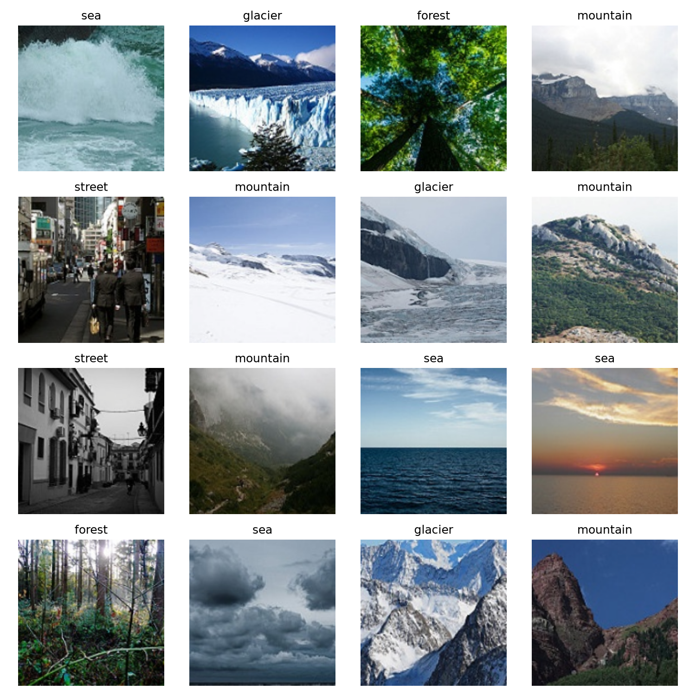
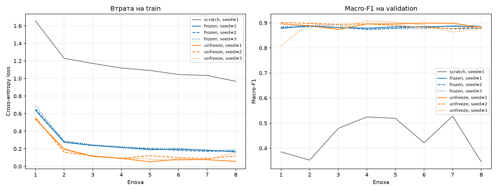
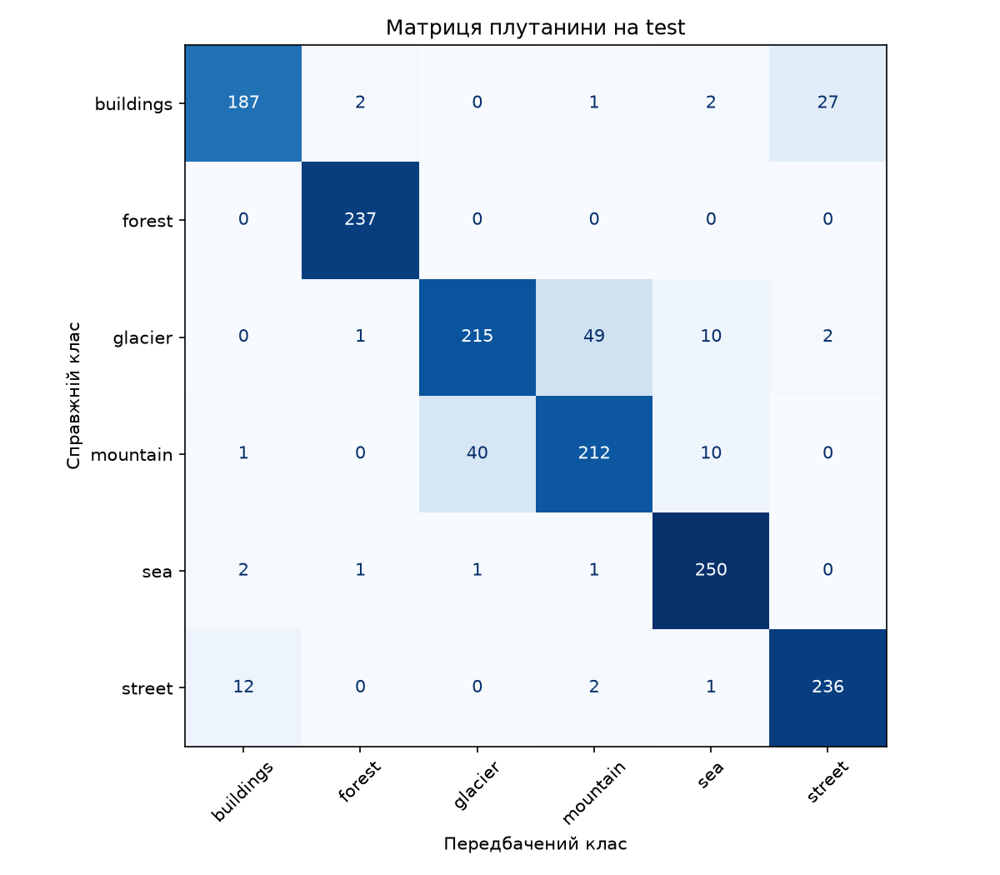
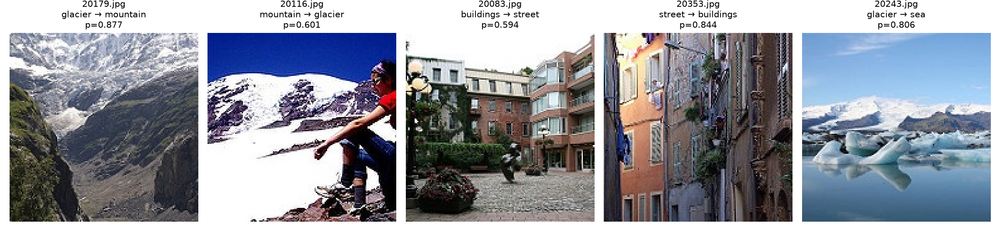

# Лабораторна робота №3

## Обчислювальний експеримент і трансферне навчання

### Мета роботи

Порівняти три режими навчання ResNet-18 на невеликій вибірці:
навчання з нуля, навчання лише останнього шару та донавчання
останнього блоку мережі разом з останнім шаром.

Визначити, який виграш дають попередньо навчені ознаки та
розморожування частини мережі, і порівняти ці різниці з розкидом
результатів між запусками.

### 1. Дані, запуск і структура проєкту

Використано Intel Image Classification із шістьма класами.

Із seg_train відібрано по 200 зображень кожного класу.
Назви файлів відсортовано як рядки, індекси перемішано
генератором NumPy із зерном 0.
Один генератор послідовно використано для всіх класів.

Для поділу seg_test створено новий генератор із зерном 0.
У кожному класі першу половину після перемішування
з округленням вниз віднесено до validation, решту — до test.

Поділ збережено у `split.csv` зі стовпцями `file`, `label`, `part`.
Подальше завантаження зображень виконується за цим файлом.

Для перевірки пораховано кількість зображень
і суму числових частин їхніх імен.
Кожна клітинка таблиці містить «кількість / сума».

| Клас | Train | Validation | Test |
|---|---:|---:|---:|
| buildings | 200 / 1 996 761 | 218 / 4 837 323 | 219 / 4 837 559 |
| forest | 200 / 2 032 625 | 237 / 5 276 962 | 237 / 5 291 326 |
| glacier | 200 / 2 183 923 | 276 / 6 135 652 | 277 / 6 157 250 |
| mountain | 200 / 1 950 345 | 262 / 5 789 535 | 263 / 5 849 765 |
| sea | 200 / 1 987 613 | 255 / 5 655 068 | 255 / 5 668 011 |
| street | 200 / 1 841 817 | 250 / 5 541 845 | 251 / 5 547 533 |
| Разом | 1200 / 11 993 084 | 1498 / 33 236 385 | 1502 / 33 351 444 |

Усі 18 контрольних клітинок збіглися з умовою.
Повторів файлів у поділі немає.

#### Запуск

Команди виконуються з теки `lab3/`
у середовищі зі встановленими залежностями.
Параметр `--data-dir` задає шлях до датасету.

Перевірки та сім запусків навчання:

```powershell
uv run --no-sync python train.py --data-dir "C:\Intel"
```

Аналіз збережених запусків і тестова оцінка на CPU:

```powershell
uv run --no-sync python analyze.py --data-dir "C:\Intel"
```

Повторне навчання перезаписує однойменні журнали й ваги.
Для аналізу готових результатів достатньо другої команди.

Залежності описано у `pyproject.toml` і зафіксовано в `uv.lock`.
Навчання та тестову оцінку виконано на CPU у форматі `float32`.

#### Основні файли

| Файл | Призначення |
|---|---|
| `data.py`, `dataset.py` | Поділ, перевірка та завантаження даних, перетворення зображень. |
| `model.py` | ResNet18, режими навчання та оптимізатор. |
| `checks.py` | Перевірки заморожування й дослід із помилкою BatchNorm. |
| `journal.py` | Журнали, версії середовища, хеші та вибір конфігурації. |
| `train.py` | Підготовка експерименту та сім запусків навчання. |
| `analyze.py` | Таблиці, графіки, тестові метрики й аналіз помилок. |

Журнали та логіти validation зберігаються в `runs/`.
Підсумкові таблиці й тестові логіти — у `results/`,
зображення — у `figures/`.
Вибрана модель збережена у `lab3_model.pt`.

### 2. Перетворення зображень і перевірки перед навчанням

Зображення відкривалися через Pillow і переводилися у формат RGB.
Для всіх режимів використано однакові перетворення.

| Частина вибірки | Перетворення |
|---|---|
| Train | RandomResizedCrop(160, scale=(0.7, 1.0)) → RandomHorizontalFlip() → ToTensor() → Normalize(mean, std) |
| Validation і test | Resize((160, 160)) → ToTensor() → Normalize(mean, std) |

Для нормування використано статистики ImageNet:

$$
\mathrm{mean} = (0.485, 0.456, 0.406)
$$

$$
\mathrm{std} = (0.229, 0.224, 0.225)
$$

Однакове нормування застосовано також у режимі scratch, щоб умови
підготовки даних були однаковими для всіх трьох режимів.

Навчальні зображення об’єднувалися в пакети по 32 з перемішуванням.
Отримано 38 пакетів за епоху, останній із яких містив 16 зображень.
Для validation і test використовувалися пакети по 64 без перемішування.
Кількість додаткових процесів завантаження — 0.

Перевірка навчального пакета дала такі результати:

- кількість навчальних зображень — 1200;
- кількість пакетів за епоху — 38;
- форма першого пакета — [32, 3, 160, 160];
- тип даних — float32.

Збережено перші 16 зображень навчального пакета після перетворень.
Для відображення виконано обернене нормування.
Над кожним зображенням указано його клас.



Перед навчанням обчислено початкову втрату на першому навчальному
пакеті для scratch і frozen із зерном 1, до першого кроку оптимізатора.

Для рівномірних імовірностей шести класів орієнтир становить:

$$
L_0 = -\ln\left(\frac{1}{6}\right)
    = \ln(6) \approx 1.791759.
$$

| Режим | Початкова втрата |
|---|---:|
| Scratch | 2.047885 |
| Frozen | 1.924394 |

Обидва значення вищі за $\ln(6)$. Це пояснюється тим, що початкові
ймовірності класів не є рівномірними. В обох режимах новий останній
шар має випадкові ваги.

Для цієї перевірки створювалися окремі екземпляри моделей.
У наступних навчальних запусках використовувалися нові моделі.

### 3. Режими навчання і перевірка параметрів

Для класифікації використано ResNet18. Останній шар моделі замінено
на Linear(512, 6), оскільки датасет містить шість класів.

Порівнювалися три режими:

- scratch — навчання всієї моделі з випадковими початковими вагами;
- frozen — використання ваг ImageNet і навчання лише останнього шару fc;
- unfreeze — використання ваг ImageNet і навчання layer4 та fc.

Загальна кількість параметрів у кожному режимі — 11 179 590.

| Режим | Параметри, які навчаються | Кількість |
|---|---|---:|
| scratch | Усі параметри моделі | 11 179 590 |
| frozen | fc | 3 078 |
| unfreeze | layer4 і fc | 8 396 806 |

Використано оптимізатор AdamW з `weight_decay = 0.0001`.
Параметри розподілено між групами так:

| Режим | Група параметрів | Кількість | Learning rate |
|---|---|---:|---:|
| scratch | Уся модель | 11 179 590 | 0.003 |
| frozen | fc | 3 078 | 0.003 |
| unfreeze | fc | 3 078 | 0.003 |
| unfreeze | layer4 | 8 393 728 | 0.0003 |

Перевірки кількості параметрів і складу груп оптимізатора пройдено.

### 4. Перевірка заморожування і BatchNorm

У режимі frozen заморожені модулі переводилися в eval,
щоб їхні статистики BatchNorm залишалися сталими.

У режимі unfreeze модулі layer4 і fc працювали в режимі навчання,
а conv1, bn1 і layer1–layer3 — у режимі eval.

Для перевірки виконано по п'ять кроків оптимізації у режимах frozen
та unfreeze з `seed = 1`. Стан моделі до і після цих кроків порівнювався
окремо для параметрів і статистик BatchNorm.

| Модуль | frozen: параметри змінилися | frozen: статистики BN змінилися | unfreeze: параметри змінилися | unfreeze: статистики BN змінилися |
|---|---|---|---|---|
| conv1 | Ні | Немає BN | Ні | Немає BN |
| bn1 | Ні | Ні | Ні | Ні |
| layer1 | Ні | Ні | Ні | Ні |
| layer2 | Ні | Ні | Ні | Ні |
| layer3 | Ні | Ні | Ні | Ні |
| layer4 | Ні | Ні | Так | Так |
| fc | Так | Немає BN | Так | Немає BN |

Усі зміни відповідають очікуванням: у frozen змінюється лише fc,
а в unfreeze — layer4 і fc. Статистики BatchNorm змінюються лише
в тій частині моделі, яка навчається.

#### Дослід із навмисною помилкою

Прогноз перед дослідом: якщо в режимі frozen викликати лише
model.train(), параметри заморожених модулів залишаться сталими,
але статистики BatchNorm змінюватимуться. Втрата може зменшуватися,
тому за її значенням цю помилку можна не помітити.

Після п'яти кроків отримано:

- параметри conv1, bn1 і layer1–layer4 залишилися сталими;
- параметри fc змінилися;
- статистики BatchNorm у bn1 і layer1–layer4 змінилися.

Для layer1.0.bn1 максимальні абсолютні зміни становили:

| Статистика | Максимальна зміна |
|---|---:|
| running_mean | 0.09283638 |
| running_var | 0.1203143597 |

Водночас втрата зменшилася з 1.886960 на першому кроці
до 1.407404 на п'ятому. Отже, зменшення втрати саме по собі
не підтверджує правильність заморожування.

Результати відповідають прогнозу. Для правильного заморожування
потрібно вимкнути обчислення градієнтів для параметрів і перевести
заморожені модулі з BatchNorm у режим eval.

Результати перевірок збережено у checks.json. Ці короткі досліди
виконувалися на окремих моделях і не входять до семи основних запусків.

### 5. Результати основних запусків

Виконано сім основних запусків:

- scratch з `seed = 1`;
- frozen з `seed = 1, 2, 3`;
- unfreeze з `seed = 1, 2, 3`.

Усі запуски виконувалися на CPU. У кожному запуску модель навчалася
протягом восьми епох. Одна епоха містила 38 пакетів, тому кожен запуск
мав 304 кроки оптимізації.

Для всіх запусків використано однаковий поділ даних.
Під час аналізу перевірено всі сім журналів і відповідність хешів split.csv.

У таблиці наведено середню навчальну втрату за восьму епоху,
macro-F1 на validation після восьмої епохи та загальний час запуску.

| № | Режим | Seed | Train loss | Validation macro-F1 | Час, с |
|---|---|---:|---:|---:|---:|
| 1 | scratch | 1 | 0.968607 | 0.345873 | 2681.8 |
| 2 | frozen | 1 | 0.165453 | 0.884201 | 1285.9 |
| 3 | frozen | 2 | 0.175656 | 0.878500 | 954.4 |
| 4 | frozen | 3 | 0.189583 | 0.888596 | 1038.7 |
| 5 | unfreeze | 1 | 0.057372 | 0.882634 | 1343.4 |
| 6 | unfreeze | 2 | 0.118082 | 0.884252 | 1197.2 |
| 7 | unfreeze | 3 | 0.160130 | 0.877439 | 1134.1 |

Результати збережено у results/runs.csv.

#### Криві навчання



Ліворуч показано зміну навчальної втрати, праворуч — macro-F1
на validation протягом восьми епох.

У режимі scratch навчальна втрата зменшувалася,
але validation macro-F1 помітно коливався.
Після восьмої епохи отримано
$\mathrm{macro\text{-}F1} = 0.345873$.

Отже, зменшення навчальної втрати не супроводжувалося стабільним
покращенням результату на validation.

Режими frozen та unfreeze вже після перших епох показували значно
вищу якість. Попередньо навчені ваги дозволили використати ознаки,
які модель отримала під час навчання на ImageNet.

У режимі unfreeze навчальна втрата була нижчою, ніж у frozen.
Однак результати на validation залишилися близькими. Тому нижча
навчальна втрата сама по собі не означає кращої якості на нових даних.

Порівняння стосується бюджету у вісім епох і 304 кроки оптимізації.
За довшого навчання результат scratch міг би змінитися.

Однакова кількість кроків не означає однакового часу виконання.
Зокрема, у frozen градієнти обчислюються лише для останнього шару,
тому один крок потребує менше обчислень, ніж навчання всієї моделі.
На виміряний час також впливає навантаження комп'ютера.

### 6. Порівняння ефектів і розкиду між запусками

Для frozen та unfreeze обчислено середнє значення validation macro-F1
за трьома seed. Розкид кожного режиму визначено як різницю між
найбільшим і найменшим результатами.

Використано такі показники:

- $`\mathrm{mean}_{\mathrm{frozen}}`$ — середній macro-F1 трьох запусків frozen;
- $`\mathrm{mean}_{\mathrm{unfreeze}}`$ — середній macro-F1 трьох запусків unfreeze;
- $`\mathrm{range}_{\mathrm{frozen}}`$ і $`\mathrm{range}_{\mathrm{unfreeze}}`$ — розкид відповідного режиму;
- $`R`$ — найбільший із двох розкидів;
- $`\Delta_{\mathrm{pre}}`$ — різниця між $`\mathrm{mean}_{\mathrm{frozen}}`$ і результатом scratch;
- $`\Delta_{\mathrm{unf}}`$ — різниця між $`\mathrm{mean}_{\mathrm{unfreeze}}`$ і $`\mathrm{mean}_{\mathrm{frozen}}`$.

Формули розрахунку:

$$
R = \max\left(
    \mathrm{range}_{\mathrm{frozen}},
    \mathrm{range}_{\mathrm{unfreeze}}
\right)
$$

$$
\Delta_{\mathrm{pre}} =
\mathrm{mean}_{\mathrm{frozen}} - F_{1,\mathrm{scratch}}
$$

$$
\Delta_{\mathrm{unf}} =
\mathrm{mean}_{\mathrm{unfreeze}} - \mathrm{mean}_{\mathrm{frozen}}
$$

| Показник | Значення |
|---|---:|
| $\mathrm{mean}_{\mathrm{frozen}}$ | 0.883766 |
| $\mathrm{range}_{\mathrm{frozen}}$ | 0.010095 |
| $\mathrm{mean}_{\mathrm{unfreeze}}$ | 0.881442 |
| $\mathrm{range}_{\mathrm{unfreeze}}$ | 0.006812 |
| $R$ | 0.010095 |
| $\Delta_{\mathrm{pre}}$ | +0.537893 |
| $\Delta_{\mathrm{unf}}$ | −0.002324 |

Результати збережено у results/effects.csv.

Для попередньої оцінки використано правило: якщо модуль різниці
не перевищує $R$, її не можна відрізнити від розкиду між запусками.
Якщо перевищує — ефект вартий подальшої перевірки, але ще не доведений.

#### Ефект переднавчання

Середній результат frozen перевищив результат scratch приблизно
на 53.789 пунктів macro-F1. Ця різниця значно більша за $R$,
який становить приблизно 1.010 пункту.

У виконаному експерименті переднавчання дало значно вищу якість
за однакового бюджету у вісім епох.

Проте scratch запускався лише з одним seed. Тому його розкид
між запусками невідомий, а розкид frozen та unfreeze не може
замінити цю оцінку. Отриманий результат показує велику різницю
в наших запусках, але не є доказом статистичної значущості.

#### Ефект розморожування

Середній результат unfreeze виявився нижчим за frozen приблизно
на 0.232 пункту macro-F1.

Модуль цієї різниці менший за $R$:

$$
\left|\Delta_{\mathrm{unf}}\right|
= 0.002324 < 0.010095 = R.
$$

Отже, різниця не відрізняється від розкиду між запусками.
Підтвердженого покращення від розморожування layer4 не отримано.

Нижча навчальна втрата unfreeze не перетворилася на вищий середній
результат на validation. За отриманими даними немає підстав
вважати один із цих двох режимів стабільно кращим за інший.

Оцінка через $R$ є наближеним способом порівняння.
Три seed дають обмежене уявлення про мінливість результатів;
$R$ не є довірчим інтервалом.

### 7. Вибір моделі та тестова оцінка

Модель вибиралася за результатами на validation у два етапи:

1. Вибір режиму з найбільшим середнім macro-F1.
2. Вибір seed з найбільшим macro-F1 у межах цього режиму.

Найбільший середній результат отримано для frozen: 0.883766.
У цьому режимі найкращим став запуск із `seed = 3`:
$\mathrm{macro\text{-}F1}_{\mathrm{val}} = 0.888596$.

Таким чином, для тестової оцінки вибрано frozen, `seed = 3`.
Використано стан моделі після восьмої епохи,
збережений у lab3_model.pt.

Вибір виконано за заданим правилом. Як показано в попередньому
розділі, невелика різниця між середніми frozen та unfreeze
не підтверджує стабільної переваги frozen.

#### Результат на test

Вибрану модель оцінено на CPU на 1502 тестових зображеннях.
Тестові результати не використовувалися для вибору режиму,
seed або кількості епох.

| Показник | Значення |
|---|---:|
| Validation macro-F1 | 0.888596 |
| Test macro-F1 | 0.891913 |
| Test macro-F1 − validation macro-F1 | +0.003317 |
| Test accuracy | 0.890146 |
| Стандартна похибка test accuracy | 0.008069 |

Тестовий macro-F1 виявився вищим за validation приблизно
на 0.332 пункту. На цих двох вибірках отримано близькі результати.

Оскільки seed вибирався за найбільшим validation macro-F1,
його validation-оцінка могла бути дещо оптимістичною.
У нашому випадку тестовий результат виявився трохи вищим,
але це не виключає впливу випадкового складу вибірок.

Стандартну похибку accuracy обчислено за формулою:

$$
\mathrm{SE} =
\sqrt{\frac{\mathrm{accuracy}\,(1-\mathrm{accuracy})}{N}},
$$

де $N = 1502$ — кількість тестових зображень.

Отримане значення 0.008069 відповідає приблизно 0.807
відсоткового пункту accuracy. Воно дає орієнтир щодо масштабу
випадкової похибки accuracy та не є довірчим інтервалом для macro-F1.

### 8. Матриця плутанини

Матриця плутанини показує, які класи модель розпізнала правильно
та між якими класами помилялася.

Рядки відповідають справжнім класам, стовпці — передбаченим.
На головній діагоналі розташовані правильні передбачення.
Усі значення є кількостями зображень.

| Справжній / Передбачений | buildings | forest | glacier | mountain | sea | street |
|---|---:|---:|---:|---:|---:|---:|
| buildings | 187 | 2 | 0 | 1 | 2 | 27 |
| forest | 0 | 237 | 0 | 0 | 0 | 0 |
| glacier | 0 | 1 | 215 | 49 | 10 | 2 |
| mountain | 1 | 0 | 40 | 212 | 10 | 0 |
| sea | 2 | 1 | 1 | 1 | 250 | 0 |
| street | 12 | 0 | 0 | 2 | 1 | 236 |



Загалом правильно класифіковано 1337 із 1502 зображень.
Кількість помилок — 165.

Найчастіше модель плутала glacier і mountain:

- 49 зображень glacier віднесено до mountain;
- 40 зображень mountain віднесено до glacier.

Разом це 89 помилок. Можлива причина — візуальна схожість:
на фотографіях льодовиків часто присутні гори, а на фотографіях
гір — сніг і лід. Взаємне плутання цих класів також пов'язане
з особливостями самого датасету.

Інша помітна пара — buildings і street:

- 27 зображень buildings віднесено до street;
- 12 зображень street віднесено до buildings.

Такі сцени можуть одночасно містити вулицю та будівлі,
що ускладнює вибір одного класу.

Усі 237 тестових зображень forest розпізнано правильно.
Для sea правильно класифіковано 250 із 255 зображень.

Матрицю збережено у results/confusion_matrix.csv,
а її зображення — у figures/confusion_matrix.png.

### 9. Приклади помилкової класифікації

Для аналізу вибрано п'ять найчастіших пар помилок зі
справжнього класу в передбачений. Для кожної пари взято
перший файл у лексикографічному порядку.

Якщо кількість помилок однакова, порядок визначається індексом
справжнього класу, а потім індексом передбаченого класу.

| Файл | Справжній клас | Прогноз | Імовірність прогнозу | Кількість помилок цієї пари |
|---|---|---|---:|---:|
| 20179.jpg | glacier | mountain | 0.877246 | 49 |
| 20116.jpg | mountain | glacier | 0.600690 | 40 |
| 20083.jpg | buildings | street | 0.593762 | 27 |
| 20353.jpg | street | buildings | 0.843923 | 12 |
| 20243.jpg | glacier | sea | 0.806478 | 10 |

Імовірність прогнозу отримано застосуванням softmax до логітів
і вибором значення для передбаченого класу.



#### Візуальний аналіз

Для наведених прикладів найбільш відповідною є категорія
«сцена містить обидва класи»: на зображеннях поєднуються
візуальні ознаки відповідних класів.

- 20179.jpg, glacier → mountain: на зображенні помітні гірські
  схили, тому сцена класу glacier також має виразні ознаки mountain.

- 20116.jpg, mountain → glacier: засніжений гірський краєвид
  візуально схожий на сцени класу glacier.

- 20083.jpg, buildings → street: будівлі оточують міський
  простір із проходом, тому сцена містить ознаки обох класів.

- 20353.jpg, street → buildings: вузька вулиця оточена фасадами,
  які займають значну частину зображення.

- 20243.jpg, glacier → sea: на фотографії одночасно присутні
  лід і велика водна поверхня, яка могла вплинути на прогноз sea.

Це візуальні пояснення можливих причин помилок.
Самої схожості недостатньо, щоб стверджувати, що мітки неправильні.

Плутання glacier і mountain відображає перекриття ознак цих
класів у датасеті. Початкові мітки збережено без змін.

### 10. Висновки

У роботі порівняно три режими навчання ResNet18: scratch, frozen
та unfreeze. Для всіх запусків використано однаковий поділ даних
і бюджет у вісім епох, тобто 304 кроки оптимізації.

Перевірки підтвердили правильність заморожування параметрів.
Дослід із навмисною помилкою показав, що вимкнення градієнтів
не зупиняє оновлення статистик BatchNorm у режимі train.
При цьому навчальна втрата може зменшуватися, тому її недостатньо
для перевірки правильності заморожування.

Середній validation macro-F1 режиму frozen перевищив результат
scratch приблизно на 53.789 пунктів. За заданого бюджету
переднавчання дало значно вищу якість. Однак scratch мав лише
один запуск, тому його мінливість між seed залишилася невідомою.

Розморожування layer4 не дало підтвердженого покращення.
Середній результат unfreeze був нижчим за frozen приблизно
на 0.232 пункту macro-F1. Ця різниця менша за спостережений
розкид $R$, який становив приблизно 1.010 пункту.

За правилом вибору на validation обрано frozen із `seed = 3`.
Модель отримала
$\mathrm{macro\text{-}F1}_{\mathrm{val}} = 0.888596$,
$\mathrm{macro\text{-}F1}_{\mathrm{test}} = 0.891913$
та $\mathrm{accuracy}_{\mathrm{test}} = 0.890146$.

Найчастіше вона плутала glacier із mountain та buildings зі street,
що узгоджується з перекриттям візуальних ознак цих класів.

Для цієї задачі frozen є доцільним початковим варіантом:
він забезпечив високу якість, навчаючи лише 3078 параметрів.
Додаткове розморожування варто перевіряти окремо, оскільки нижча
навчальна втрата не гарантує покращення на validation.

Для подальшого дослідження можна виконати кілька запусків scratch
із різними seed та окремо перевірити вплив довшого навчання.
Висновки поточної роботи стосуються використаних даних,
налаштувань і бюджету у вісім епох.

### Використані джерела

- Методичні вказівки до ЛР3 «Обчислювальний експеримент і трансферне навчання», матеріали курсу «Системи глибинного навчання».
- ChatGPT використано для допомоги з коригуванням коду, підготовкою та редагуванням тексту звіту.
